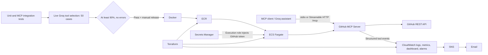

# GitHub MCP Server — AI DevOps demonstration

A Python Model Context Protocol server exposing 21 GitHub tools, with a Groq-powered CLI assistant and an AWS ECS Fargate deployment defined in Terraform. Built to demonstrate how an AI application can combine controlled tool access, container delivery, infrastructure as code, observability and an AI quality release gate.



## Capabilities and stack

Python 3.12, MCP SDK 2.0.0, HTTPX, python-dotenv, Groq SDK, pytest, Docker, Terraform and AWS (ECR, ECS Fargate, IAM, Secrets Manager, CloudWatch, SNS). Runtime dependencies are in `requirements.txt`; assistant/evaluation/test dependencies are in `requirements-dev.txt`.

Tools: `get_repository`, `search_repositories`, `get_file_contents`, `list_directory`, `list_issues`, `get_issue`, `create_issue`, `list_pull_requests`, `get_pull_request`, `create_pull_request`, `list_branches`, `get_branch`, `create_branch`, `list_commits`, `get_commit`, `search_code`, `search_issues`, `search_pull_requests`, `list_labels`, `add_labels_to_issue`, `create_or_update_file`.

Read-only mode omits the five write tools. The interactive assistant asks for write confirmation; direct MCP clients do not inherit that CLI confirmation. GitHub HTTP requests have bounded timeouts and read retry logic; writes are not blindly retried.

## Local setup (PowerShell)

```powershell
python -m venv .venv
.\.venv\Scripts\Activate.ps1
python -m pip install -r requirements-dev.txt
Copy-Item .env.example .env
# Populate .env privately; never commit it.
python -m app.server
# In another activated terminal:
python -m client.assistant
```

`python -m app.server` defaults to stdio. For a local HTTP server:

```powershell
$env:MCP_TRANSPORT='streamable-http'
$env:MCP_HOST='127.0.0.1'
$env:MCP_PORT='8000'
$env:GITHUB_MCP_READ_ONLY='true'
python -m app.server
```

HTTP exposes `/health` (process health, not a GitHub dependency probe) and `/mcp`. Use `MCP_SERVER_URL` to connect the client to HTTP; unset it to use a spawned local stdio server. The client uses its current Python interpreter.

| Variable | Purpose / default |
|---|---|
| `GITHUB_TOKEN` | Required server credential; minimum repository permissions for intended tools |
| `GROQ_API_KEY` | Required for assistant and live evaluation |
| `GROQ_MODEL` | `openai/gpt-oss-20b` |
| `MCP_SERVER_URL` | Optional remote HTTP MCP endpoint |
| `MCP_TRANSPORT` | `stdio`; Docker uses `streamable-http` |
| `MCP_HOST`, `MCP_PORT` | HTTP binding; Docker uses `0.0.0.0:8000` |
| `GITHUB_MCP_READ_ONLY` | Disable write-tool registration; Docker/Terraform use `true` |
| `GITHUB_API_TIMEOUT` | Positive GitHub HTTP timeout in seconds; default 30 |
| `LOG_LEVEL` | Default `INFO` |
| `EVALUATION_MIN_ACCURACY` | Default 90; only 90–100 accepted |

## Evaluation and quality gate

```powershell
python -m pytest -q -p no:cacheprovider
Remove-Item Env:MCP_SERVER_URL -ErrorAction SilentlyContinue
$env:GITHUB_MCP_READ_ONLY='false'
$env:MCP_TRANSPORT='stdio'
python -m evaluation.evaluator
```

Evaluation measures **single tool-name selection**, using all 50 unchanged prompts in `evaluation/test_cases.py` and the actual MCP tool descriptions. It does not execute tools, validate arguments, measure answer correctness or evaluate the assistant's full tool-use loop. Use a local full catalog, since the cases include write tools that are absent from the deployed read-only server. A placeholder GitHub token suffices for catalog discovery; no GitHub API calls are made by evaluation.

The evaluator checks the selected model against the authenticated Groq model list. It requests strict JSON-schema output with temperature 0, seed 42, low reasoning effort and a 4096-token completion budget, validates the exact response shape and tool membership, and uses SDK timeouts and two retries for transient failures/rate limits. Deterministic settings reduce variation but cannot guarantee identical model output. The default model is listed in [Groq's supported models](https://console.groq.com/docs/models); account availability is checked at runtime. Strict structured output support is required for any model override; see [Groq structured outputs](https://console.groq.com/docs/structured-outputs).

`evaluation/results.json` is a fresh ignored live report containing model, time, settings, dataset/catalog hashes, per-case outcomes and totals. Exceptions are recorded by class only. A result passes only with at least 90% correct and **zero** API/parsing errors. Missing credentials, invalid catalogs, crashes and incomplete startup exit nonzero; stale success reports are removed first. `evaluation/predictions.json` is a legacy unprovenanced artifact and is never used to authorize release.

Pytest collects safe tests from `tests/`; the existing manual remote/demo scripts are intentionally not automatic tests. Fixture tests cover 50/50 success, 45/50 success, 44/50 failure, and 49/50 correct plus one API error failing. These are evaluator logic tests, not live model scores. Local MCP integration verifies discovery of all 21 tools without calling GitHub.

`.github/workflows/release.yml` runs local tests before live evaluation on PRs, main pushes and manual dispatch. The deployment job requires both jobs to succeed, a manual dispatch with `deploy=true`, and the main branch. Fork PRs without Groq secrets fail closed. No fixture fallback permits release. Configure the repository secret `GROQ_API_KEY`, repository variable `AWS_DEPLOY_ROLE_ARN`, an AWS OIDC trust restricted to the repository's production environment, and **required reviewers on the GitHub `production` environment** before use. Branch protection should require the tests/evaluation checks. These repository settings have not been configured by this local change.

## Docker and AWS deployment

```powershell
docker build -t github-mcp-server:local .
docker run --rm --env-file .env -p 127.0.0.1:8000:8000 github-mcp-server:local
terraform -chdir=infra fmt -check
terraform -chdir=infra validate
terraform -chdir=infra plan -input=false
```

Docker runs as a non-root user. Terraform defines the default VPC/subnet deployment, public task networking, TCP 8000 restricted to `allowed_cidr`, ECR, ECS service, task/execution roles, secret container and monitoring. Set private ignored `infra/terraform.tfvars` values for `allowed_cidr` (a trusted IPv4 `/32`) and `alert_email`. Region defaults to `ap-southeast-2`. Never put secret values in Terraform variables/state: the execution role reads the existing secret into the task; the application task role has no AWS permissions.

Review and explicitly approve infrastructure changes before applying. Terraform state is local and ignored; encrypted remote state and locking remain future work. Existing destructive settings include ECR `force_delete` and zero-day secret recovery; use caution with teardown.

The release workflow builds the checked revision, pushes SHA and `latest` image tags, forces a new deployment of the existing `latest` task definition, then waits for ECS stability. Cluster: `github-mcp-server-cluster`; service: `github-mcp-server`. It requires an existing provisioned service and least-privilege deployment role. Deployment has not been run in this work. The mutable `latest` tag is retained to match Terraform; immutable task-definition image digests and automated rollback are future improvements. The task public IP can change on replacement; discover the current task network interface before a remote demo.

## Monitoring and security review

Tool calls emit JSON with tool name, status, duration and exception class, without arguments. `/ecs/github-mcp-server` retains logs for seven days. Metric filters publish `GitHubMCP/ToolCallErrors` and `ToolCallLatency`. The error alarm sums failures over five minutes and triggers at three; latency alarms on an average above 5000 ms over five minutes. Missing data is nonbreaching. The dashboard shows errors and latency, and alarm actions publish to SNS email (subscription confirmation required).

See [infrastructure review](docs/INFRA_REVIEW.md) for state evidence and the proposed narrowly scoped ingress correction. HTTP has no application authentication or TLS in the current deployment; network restriction and GitHub read-only mode are essential demo controls. Do not expose it broadly. Fargate, ECR, logs, dashboards, secrets and model requests can incur costs.

## Verification

Historical verification **reported by the project owner**, not repeated during this work: remote MCP repository invocation at 437.02 ms; error metrics recorded; three deliberate failed tool calls triggered the threshold-three alarm and an SNS email was received. This verifies the reported pipeline MCP → ECS → CloudWatch → SNS → email, not a current availability guarantee.

Current local checks: 27 tests passed; the latest full live Groq evaluation passed with 49/50 correct (98%), one wrong-tool answer and zero API errors. Earlier runs failed safely on provider errors. This is local live evaluation evidence. The first GitHub Actions run failed during MCP catalog testing because the SDK subprocess did not inherit application variables; an explicit server-environment forwarding fix passes locally and awaits hosted verification. No deployment was run. Detailed verification and live evaluation results are recorded in [verification report](docs/VERIFICATION.md). No AWS mutation or deployment was performed during local verification. See [interview preparation](docs/INTERVIEW_PREP.md) for an honest project explanation and questions.
